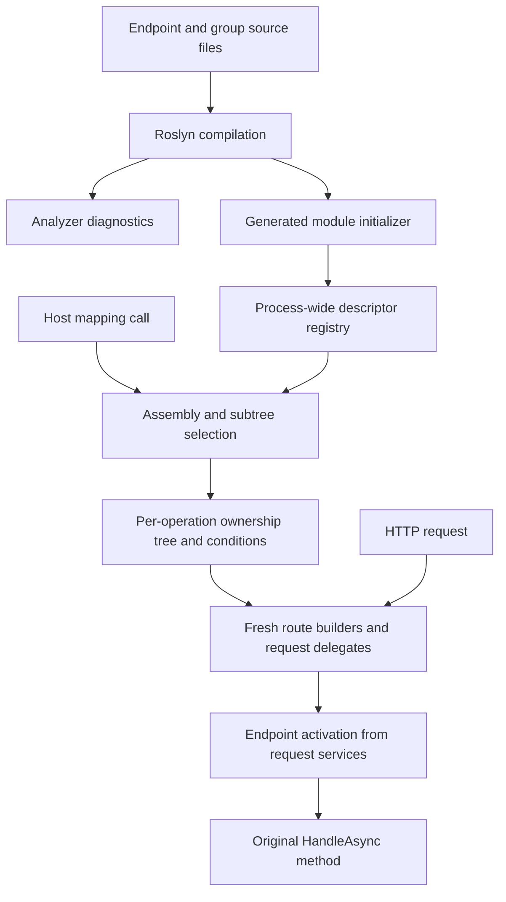

# Runtime and generator architecture

[Documentation index](README.md)

## Components

| Component | Responsibility |
| --- | --- |
| Runtime interfaces | Endpoint shape, verbs, namespace definitions and the manual-mapping marker |
| `EndpointRegistrationGenerator` | Discover declarations and emit registration descriptors into each compilation |
| `EndpointRouteAnalyzer` | Check supported route/handler source shapes and report diagnostics |
| `EndpointRegistry` | Store generated descriptors and coordinate mapping operations |
| `MediumApiEndpointNameExtensions` | Supply late native fallback name metadata and optional alias/group suppression |
| `NamespaceGroupMetadata` | Forward supported declared policies, output caching, documentation metadata, response headers and filter markers on enabled namespace mounts |
| `IMediumApiEndpointFilter` | Pair a native filter with static metadata/conventions, without changing dispatch or exception policy |
| `ResponseHeaderAttribute` / `MediumApiResponseHeaderExtensions` | Constant replacing headers at explicit handler/group/filter boundaries, optionally selected by returned result type |
| Optional `RouteSyntaxCodeFixProvider` | Offer a design-time ENDPOINT005 annotation edit, outside runtime registration |
| `MediumApiDiscoveryOptions` | Collect the exact assemblies selected by a host |
| `MediumApiDiscoveryProfile` | Snapshot an immutable reusable assembly selection |
| `EndpointHandlerAdapter` | Integrate the original method with native filters, default owned targets and explicit service resolution |
| `EndpointMappingContext` | Expose host startup services to namespace conditions |
| `MediumApiManifest` | Snapshot selected endpoint/group declarations without applying host conditions |
| `MediumApiRouteReport` | Snapshot composed route data sources and narrowly identify duplicate registrations |
| ASP.NET Core | Create and execute request delegates, route requests and apply the configured HTTP pipeline |

## Compilation

The incremental generator examines concrete non-static class declarations. It
identifies endpoint implementations, reads supported compiler-proven string
expressions and detects optional static configuration. Namespace definitions are
recognized through `INamespaceEndpointGroup`. Constant-expression metadata
shares its semantic reader with route analysis. See the
[verification record](testing-and-development.md#current-verification-record)
for executed generator, analyzer and example checks.

Local route diagnostics recognize terminal `{*name}` and `{**name}` tokens,
optionally with one simple argument-free constraint,
through a separate guarded expression, leaving ordinary-token parsing and the
inherited-layout gate unchanged. This is an analyzer-only addition; routing,
binding, link generation and registration remain native. See
[catch-all routes](catch-all-routes.md) for the supported grammar and examples.

A higher-priority guarded alternative recognizes common terminal ordinary
constrained optional/default tokens. It extracts the base constraint without
evaluating defaults, while the legacy ordinary and catch-all alternatives remain
byte-identical. Extraction method, type mapping and the inherited-layout gate are
unchanged; existing optional parent shapes can retain their constraint type and
default-valued layouts remain unknown. See [optional/default routes](optional-default-routes.md).

Inherited-prefix analysis also recognizes exact native rate-limiting fluent
conventions. Named-policy and disable calls retain the one-generic-argument
contract; only the exact typed-policy overload permits two, with native policy
identity and matching partition type parameter. Existing convention branches
remain restricted as before. Arguments and policies are not executed by analysis;
see [rate-limiting prefix conventions](inherited-route-binding.md#rate-limiting-conventions).

A separate symbol-only reader checks exact explicit route properties of supported
native `[AsParameters]` classes. Original aggregate parameters remain opaque for
missing-token guesses; additional member checks reuse existing primitive/parser
rules and namespace layouts. No request-time flattening, binder or generated
signature changes are introduced. See [aggregate route checks](aggregate-route-bindings.md).

Immutable constructor-bound requests have a separate symbol-only reader. It
matches native constructor/property names and CLR types, combines known source
evidence conservatively and returns the same route-member records to established
diagnostic code. Runtime binding and generated registrations remain native and
unchanged; see [constructor route checks](constructor-route-bindings.md).

The generator collects partial namespace-definition declarations by type, rejects multiple definition types in the same namespace, and emits `MediumApiEndpointRegistration.g.cs`. Its initializer registers group factories and endpoint mapper factories. The generated initializer is in the declaring assembly, so internal endpoint types can be used without making the HTTP adapter public.

The emitted registration contains the route literal, HTTP verb, authorization-policy value, optional named partition and automatic-mapping flag. The runtime does not instantiate an endpoint to read these properties. `ShouldMap` remains executable startup code, invoked through the namespace interface's static member when a mapping operation needs it.

## Module initialization and the registry

The registry holds endpoint descriptors, namespace-definition descriptors and legacy callbacks. A descriptor includes a declaring type or assembly and mapping delegates. This registration state is process-wide and protected by locks while descriptors are added or snapshots are taken.

Registering a descriptor does not register a route in a host. Mapping later creates builders and request delegates for that host. This distinction allows several independent hosts to use the same registered endpoint types.

Scoped discovery explicitly runs the selected manifest module constructors before taking its filtered descriptor snapshot. The broad compatibility path instead discovers managed assemblies in the application directory and already loaded assemblies. That broad loading attempt is cached process-wide and has best-effort handling for assemblies it cannot initialize. Selected-module initialization errors in scoped discovery are allowed to propagate.

## A mapping operation

The operation takes a snapshot of applicable descriptors and computes:

- Each namespace definition's closest ancestor in the same assembly.
- Each automatic endpoint's closest namespace owner in the same assembly.
- A per-operation enabled-state dictionary and startup context.

It visits root definitions, evaluates their conditions and maps enabled subtrees.
For an enabled definition, the order is its `Map`, supported directly declared
[group policy metadata](group-policies.md), the optional host callback, its direct
endpoints, then its children. Supported attributes are inspected without invoking
unrelated constructors and receive fresh instances for that mapping operation;
disabled definitions construct none. No group object is created. Unowned automatic
endpoints map at the supplied root. Applicable legacy callbacks are invoked
separately after the namespace-based mappings.

Ownership is determined before enablement, so a disabled group cannot cause its handlers to fall back to the root. Parent conditions short-circuit descendants. Builders, contexts and enabled results belong to this operation and are not retained as global registry state.

The exact native `EndpointGroupNameAttribute` follows this same metadata path.
API Explorer reads the effective native group name; provider inclusion stays
host-owned. API description snapshots already retain `GroupName`; raw route
snapshot fields and generated registrations are unchanged. See
[document groups](document-groups.md).

The exact native `RequireAntiforgeryTokenAttribute` follows this same path with
ordinary group metadata ordering. Native form binding and middleware own token
validation and failures; final opt-out conventions are not reordered. Existing
snapshots already capture the effective value. See [antiforgery](antiforgery.md).

The exact native `OutputCacheAttribute` also follows the existing definition
metadata path. Construction, named arguments and per-mount instance ownership are
unchanged. The native middleware selects and composes cache policies; MediumAPI
adds no cache store or dispatch policy. See [output caching](output-caching.md).

The exact native `HostAttribute` also follows the definition metadata path and
the endpoint-class hook below. Native routing reads the last effective host list;
entries are alternatives and empty metadata accepts any host. No matcher or host
filter is added. Existing snapshots omit Hosts; see [host routing](host-routing.md).

Exact native `RequestTimeoutAttribute` and `DisableRequestTimeoutAttribute`
also use the definition and endpoint-class hooks. Host services/middleware and
native policy-object priority, cooperative cancellation and response handling
are unchanged. Existing snapshots omit timeout fields; see
[request timeouts](request-timeouts.md).

Exact native `RequestSizeLimitAttribute` and `DisableRequestSizeLimitAttribute`
use both existing metadata readers. Namespace declarations remain after `Map`
and before callbacks; endpoint declarations remain before inferred/method
metadata. Native routing reads the last effective `IRequestSizeLimitMetadata`
and sets a writable server feature. No MVC filters, byte counter, generator
change or synthetic 413 declaration is added. See
[request body limits](request-body-limits.md).

Exact native `RequestFormLimitsAttribute` uses both existing metadata readers.
Its `IFormOptionsMetadata` retains native per-property last-non-null merging;
every attribute property supplies a value, including native defaults. Original
methods, providers, endpoint conventions and native final conventions retain
their order. Native form features own parsing/cache behavior; no parser, MVC
filter, generator or synthetic error metadata is added. See
[form limits](form-limits.md).

Exact `EndpointResponseAttribute` declarations now use the namespace and endpoint
class readers. Group placement remains after Map/before callback; endpoint
placement remains before inference/method metadata. Registered filter-class
declarations use a small declared-only helper at combined filter registration:
optional Configure, custom metadata, native request contracts, native antiforgery opt-outs, explicit
responses, response fallbacks, headers, then native filter registration. No
global metadata cache, status merge or response execution is introduced. Original
method handling, activation and snapshot schemas retain their implementation.
See [shared responses](shared-response-declarations.md).

Definition traversal is ordered by assembly identity and namespace, with child namespaces ordered ordinally. Generated endpoint registration is ordered by fully qualified type name. Do not use incidental source-file or registration order as an application routing contract; use unambiguous patterns and explicit framework conventions.

Endpoint classes contribute direct `IAuthorizeData`/`IAllowAnonymous` and exact
native `EnableCorsAttribute`/`DisableCorsAttribute`, `OutputCacheAttribute`,
`EnableRateLimitingAttribute`/`DisableRateLimitingAttribute`,
`RequireAntiforgeryTokenAttribute`, `TagsAttribute`,
`EndpointGroupNameAttribute`, `ExcludeFromDescriptionAttribute` and
`HostAttribute`, `RequestTimeoutAttribute`, `DisableRequestTimeoutAttribute`,
`RequestSizeLimitAttribute`, `DisableRequestSizeLimitAttribute` and `RequestFormLimitsAttribute`
declarations in the adapter's native metadata-inference callback.
This runs after group conventions and before ordinary inferred metadata and
handler attributes.
Endpoint types are not instantiated for that step. Attribute objects are created
per native builder materialization; class base/interface attributes are not
imported. Generated authorization/configuration calls retain their order. See
[endpoint authorization](endpoint-authorization.md), [endpoint CORS](endpoint-cors.md),
[endpoint output caching](endpoint-output-caching.md),
[endpoint rate limiting](endpoint-rate-limiting.md),
[endpoint antiforgery](endpoint-antiforgery.md),
[endpoint documentation](endpoint-documentation.md) and
[host routing](host-routing.md),
[request timeouts](request-timeouts.md) for native composition
and legacy mapper boundaries.

## Creating a handler adapter

For each mapped endpoint, current generated code conceptually performs:

1. Obtain the endpoint's public `HandleAsync` `MethodInfo` using reflection.
2. Create an open instance delegate for the original method without constructing a target.
3. Call `RouteHandlerServices.Map` with that delegate, pattern, verb, metadata inference and request-delegate factory callbacks.
4. Let ASP.NET Core apply composed-route binding options, original method metadata and group/endpoint filter factories.
5. Apply named-link conventions for method-level endpoint names.
6. Apply the generated `AuthorizationPolicy` value when present.
7. Invoke the endpoint's optional `Configure` and return its `RouteHandlerBuilder`.

This preserves the original signature for API Explorer and metadata consumers instead of exposing only an adapter's `HttpContext` signature. It does not generate every binding operation at compile time, and it does not execute MVC filters merely because their attributes are present.

The custom callback uses `RequestDelegateFactory.Create` with the original method
and the framework's options/metadata result. Filter factories therefore see that
method, and invocation contexts contain its original bound arguments. The public
`RouteHandlerServices` hook is framework infrastructure intended for generated
handlers; verify it when upgrading the framework. Reflection and dynamic delegate
creation remain startup operations.

Inside the existing inference callback, the adapter first adds a fresh
`MediumApiEndpointMetadata(typeof(TEndpoint))`, then applies existing endpoint
class metadata, then calls native `RequestDelegateFactory.InferMetadata` with the
original method. Providers therefore see the concrete mapped type without
replacing `MethodInfo`. Ordinary group conventions precede that marker; inferred/method
metadata and ordinary/final endpoint conventions retain their native order.
The route report prefers the effective marker, retaining its original
`IEndpoint` method-owner heuristic when absent. No registry lookup, startup
endpoint construction or generator change is required. See
[endpoint identity](endpoint-identity.md).

Endpoint class and handler response-header declarations are snapshotted at mapping.
The request-delegate callback installs their native filter factory after ordinary
filter conventions and immediately before `RequestDelegateFactory.Create`. This
retains the handler boundary: binding failures and outer-filter short circuits do
not acquire a header from an uncalled handler. The innermost factory mirrors the
native terminal's status-at-least-400 skip guard; ordinary outer group filters
can still run after parameter parsing fails. `Finally` conventions run too late
to add this filter because native request-delegate creation has already happened.
Group/filter declarations and explicit fluent headers use normal native filter
registration points. Conditional result selectors inspect returned results before
execution without wrapping/replacing them. See [response headers](response-headers.md).

`ResponseHeader.ResultTypes` normalizes a nonempty selector array into the same
immutable policy used by a singular `ResultType`. A match against any selector at
any visited result level applies that declaration once. No selector matches a
future status code or runs an `IResult`. The same 32-level traversal bound,
response-start guard and handler/filter placement remain. Input/read-back arrays
are defensive copies; conflicting singular/plural configuration fails during
snapshot. No adapter, registry, generator or snapshot-schema changes are needed.

The adapter also installs an endpoint final convention. If no explicit name or
suppression marker is present, it supplies the simple endpoint type name without
one final `Endpoint`, plus native route-name metadata when none exists. This runs
after ordinary conventions, so method attributes, filters, static configuration
and host `WithName` overrides retain precedence. No global uniqueness rewrite or
name cache is introduced. See [names and aliases](endpoint-names.md).

## Opt-in custom attribute metadata

`IEndpointMetadataAttribute` extends the existing endpoint/namespace declaration
predicate; each selected declaration follows one materialization path. The filter
helper applies directly declared opted-in objects after optional Configure and
before request/response/header declarations. Original method handling is unchanged.
`EndpointAttributeMetadata` shares the existing constructor/named-argument/ReadValue
algorithm with the class, namespace and native Consumes readers. No descriptor,
generator, target activation, cache or snapshot-schema change is required. See
[custom metadata](custom-metadata.md) for native phases and shared object ownership.

## Bulk explicit alias registration

MapMediumApiEndpointAliases materializes input/null validation, then calls the
existing single mapping path and fallback-name suppression once per alias. It
returns a native RouteHandlerBuilder over a fixed array of mapped child builders;
native Add/Finally fan out without remapping. Empty input performs no descriptor
lookup. There is no registry, generator, adapter, activation or snapshot-schema
change. See [bulk aliases](bulk-aliases.md) for native object sharing and failure
boundaries.

## Request activation

Supported filter markers are applied to each mapped endpoint's declared class,
then its original handler attributes, before later generated/static configuration.
Namespace markers are applied after group `Map` and before host callbacks. Static
filter conventions and native `AddEndpointFilter` registrations run during mapping;
request-time filter activation remains framework-owned. Filter conventions do not
change the adapter's target selection or cleanup. The default endpoint path owns
its target; `[EndpointFromServices]` instead selects native required-service
resolution and leaves cleanup to DI/application ownership. See
[filter conventions](exception-filters.md) for
inheritance, repeated registrations, constructor ownership and exception boundaries.

Namespace class metadata includes the exact native `TagsAttribute` and
`ExcludeFromDescriptionAttribute` types alongside the existing policy/filter/header
contracts. The reader remains declared-only and constructs fresh instances for
each enabled mount. It does not select arbitrary documentation interfaces or
inspect group `Map` method attributes. Summary/description defaults remain native
builder calls. See [namespace metadata](namespace-metadata.md).

The whitelist also forwards exact native `EnableRateLimitingAttribute` and
`DisableRateLimitingAttribute` declarations. It does not install services or
middleware, construct policies or change native global/endpoint rejection and
disable behavior. Actual endpoint metadata and middleware requests are needed to
verify these policies; existing snapshot models omit rate-limit fields. See
[namespace rate limiting](rate-limiting.md).

Filter declarations accept ordinary `IEndpointFilter` classes. When the type also
implements `IMediumApiEndpointFilter`, a cached constrained-interface dispatch
delegate applies its static conventions for each registration. The cache retains
no builder, request services or availability decision; plain filters skip that
step. Existing declared-header and native filter registration order is preserved.
The bridge adds runtime reflection and makes no trimming/AOT guarantee.

By default, when the request delegate needs its target instance, it invokes `ActivatorUtilities.CreateInstance<TEndpoint>` against `HttpContext.RequestServices`. Constructor and handler service dependencies therefore come from that request's service provider. No request service is resolved to inspect endpoint properties at startup.

The default endpoint is created by the adapter rather than resolved as a registered
endpoint service. A private per-dispatch activation entry reuses that target across
factory/filter invocations. The adapter awaits the full request delegate, including
result execution, then cleans up the target in `finally`: asynchronous disposal
takes precedence over synchronous disposal. The private entry is removed/restored
even on failure. DI dependencies retain their normal service lifetimes. Binding
failure or filter rejection can happen after target activation; all successfully
created targets still receive cleanup. See [ownership details](filters-and-lifetime.md).

A direct `EndpointFromServices` marker is checked on the mapped type at mapping,
without resolving a service. The same dispatch activation entry then lazily uses
native required-service lookup instead of owned creation. Its cleanup skips
returned service targets; native DI/application lifetime owns them. No provider
or target is cached globally, and no new scope is created. Default creation and
disposal remain intact. Original method inference, metadata, headers, filters and
result execution keep their existing implementation. See
[service endpoint activation](service-endpoint-activation.md).

## Compatibility contracts

Preserve these surfaces when changing the generator or runtime:

| Surface | Reason |
| --- | --- |
| `Register(Action<IEndpointRouteBuilder>)` | Previously compiled generated registration callbacks |
| Earlier generic `Register<TEndpoint>` overload | Generated modules compiled against the earlier runtime contract |
| No-argument mapping overload | Existing broad-discovery consumers |
| Legacy named-group mapping overloads | Applications migrating from explicit string partitions |
| Non-null typed namespace mapper | Existing callers expect a `RouteGroupBuilder`; disabled groups now fail explicitly |
| Default-true `ShouldMap` | Existing definitions do not need a new member |
| Original handler metadata and names | Documentation, binding descriptions and link generation |
| Per-host mapping state | Independent hosts must not share builders or condition results |

New generated code can depend on newer runtime APIs. Keeping older overloads does not mean that a new generator can be paired with any old runtime. Treat the two projects as a coordinated source/version pair.

## Boundaries and open engineering questions

The current approach uses runtime reflection and request-delegate creation. Trimming, Native AOT, startup cost, hot reload and collectible assembly-load contexts need their own design and verification. Assembly descriptors have process lifetime; this is not a plugin unload/reload framework. The adapter owns only targets it creates; legacy callbacks and older compiled mappers retain their own activation/disposal behavior.

Application services, database models, identity adapters, serialization settings and provider transports remain outside the generator. Native framework registrations can coexist with generated endpoints. A group definition can invoke a native mapping, but the library does not need to reimplement the transport behind it.

See [diagnostics and limitations](diagnostics-and-limitations.md) and the [roadmap](roadmap.md) before extending this architecture.

## Additive inspection source PoC — 16 November 2026

Generated registrations now also supply literal pattern and HTTP method values to
a new overload, with prior overloads preserved. `EndpointRegistry.GetManifest`
uses selected descriptors to report ownership and manual-mapping state. It does
not evaluate namespace conditions or infer host exposure.

`GetMediumApiRouteReport` explicitly reads actual builder data sources and returns
read-only route/conflict snapshots. It is not called during mapping. The optional
`ThrowIfConflicts` is also caller-controlled. No global host-state cache or public
diagnostics HTTP route is added. See [inspection](inspection.md) for the comparison
rules and the distinction between declarations and composed host routes.

The follow-up example projects exercise declaration inspection, narrow conflicts,
profiles, response metadata and the new filter/lifetime pipeline. See the
[verification record](testing-and-development.md) for framework versions, exact
counts and checks that remain outside the example coverage.
## Request declarations and final antiforgery opt-outs

[Consumes](accepted-request-contracts.md) supplies native IAcceptsMetadata.
Endpoint classes contribute defaults before inference; original handler attrs
retain post-inference precedence. Namespace and combined filter declarations use
their existing registration points. Neither schema metadata nor IsOptional changes
handler parameters or installs a parser. Native routing still owns media matching.

[DisableEndpointAntiforgery](antiforgery-opt-outs.md) delegates to the native final
convention. It is supported directly on mapped classes, methods, namespace
definitions and combined filter types. Class lookup is direct-only; original
handler inheritance remains. Combined filter order is optional Configure, custom metadata, declared
accepts, native opt-out, declared responses, response fallbacks, declared headers
and native filter.
No services, middleware, target resolution or alternate security engine is added.

## Missing-response conventions

`EndpointResponseFallbackAttribute` is a marker, not
`IProducesResponseTypeMetadata`. Its existing response-value template retains
constructor defaults, eager validation and immutable media values. The declared
helper imports class markers directly; the adapter also applies original handler
markers with method inheritance. It registers ordinary endpoint `Add` callbacks
after mapping, where inference and original method metadata are already visible.

Namespace markers and combined filter registration on a RouteGroupBuilder use
native `Finally`, so descendant metadata and endpoint finals precede the check.
Other convention builders keep ordinary `Add`. Each callback checks any existing
response metadata by status and appends an existing EndpointResponseAttribute
only if absent. Later callbacks can still add another response. There is no
global scan, merge, runtime filter, target resolution or snapshot schema change.
See [response fallbacks](response-fallbacks.md).
