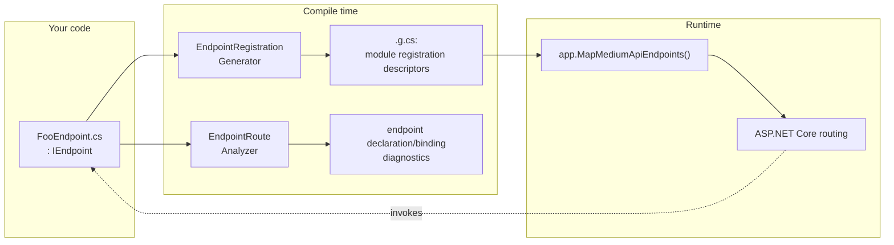
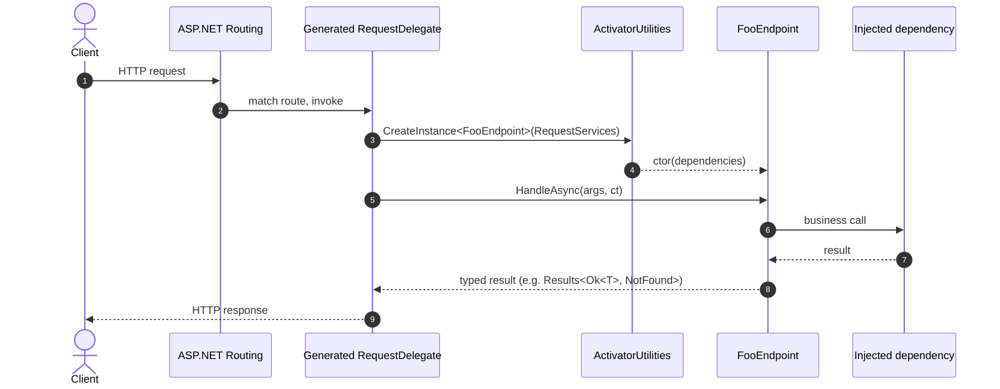

# RonSijm.MediumAPI

For NuGet package builds, versioning and trusted publishing setup, see
[building and publishing NuGet packages](Docs/nuget-publishing.md).

Name an existing static native filter factory by deriving from `EndpointFilterFactoryAttribute<TFactory>`. Application aliases preserve fixed Configure/Create dispatch and original handler arguments. See [factory aliases](Docs/factory-aliases.md).

Give an existing endpoint filter an application-owned attribute name by deriving from `EndpointFilterAttribute<TFilter>`. Named declarations keep fixed filter selection, native activation and the existing registration phase. See [filter aliases](Docs/filter-aliases.md).

Use `AddConditionalConvention(condition, convention)` to apply an existing native endpoint configuration action only when its materialization-time condition holds. It preserves ordinary Add ordering and caller-owned metadata. See [conditional conventions](Docs/conditional-conventions.md).

Give an existing startup convention an application-owned name by deriving from `EndpointConventionAttribute<TConvention>`. Named attributes retain the same static dispatch and native registration position. See [convention aliases](Docs/convention-aliases.md).

Related read endpoints can share native optional query inputs while preserving wire names, binding diagnostics and normalization. The [shared-query guide](Docs/shared-query-inputs.md) and extended documentation example cover complete generated OpenAPI and native HTTP comparisons.

Name repeated header policies with an application-defined `ResponseHeadersAttribute` set. Its children retain their existing handler/group/filter boundary, selectors and ordering. See [response-header sets](Docs/response-header-sets.md).

Simple endpoints can now use `[EndpointPattern("/items/{itemId:long}")]` on a partial class instead of writing a `Pattern` property. The generator preserves the existing registration and native routing. See [declarative endpoint patterns](Docs/endpoint-patterns.md).

Applications can name repeated native header bindings while retaining the original FromHeader metadata family, optional inputs and argument positions. See [named header bindings](Docs/named-header-bindings.md) and the extended binding example.


Related read handlers can share explicit native `[AsParameters]` route inputs while retaining their wire contracts. See [shared route inputs](Docs/shared-route-inputs.md) for argument-shape, filter and verification boundaries.


Application-defined response sets can now retain existing child metadata, including payload/media contracts and response subclasses, through a protected list constructor. See [payload response sets](Docs/payload-response-sets.md).


Use `[EndpointResponses(401, 403)]` or an application alias to share status-only response contracts at their existing metadata positions. See [reusable response sets](Docs/response-sets.md) for supported owners, ordering and native mapping boundaries.


Uniform namespace tags can replace repeated handler tags through existing native group metadata, while standalone mounts retain explicit documentation metadata. See [namespace tag defaults](Docs/namespace-tag-defaults.md) for migration boundaries and runnable verification.


Simple namespace groups can now use `[NamespaceRouteGroup("/api")]` on a partial definition instead of repeating a `Map` method. It generates the same native call; custom mapping remains explicit. See [declarative namespace prefixes](Docs/declarative-namespace-prefixes.md).


Applications can now specialize `EndpointResponseAttribute`, reusing its constructor/default metadata at the original response phase. See [derived response declarations](Docs/derived-responses.md) and the extended shared-response example.


Startup conventions can now call `AddMediumApiConvention<T>()` on their `IEndpointConventionBuilder`, allowing shared policy subsets to compose in ordinary registration order. See [convention composition](Docs/convention-composition.md).


Combined filter and factory registration now accepts `IEndpointConventionBuilder`, so startup conventions can share complete native policies directly. See [browser policy conventions](Docs/browser-policy-conventions.md) and the extended native-filter example.


Applications can now derive from `ResponseHeaderAttribute` to declare reusable policies such as `[NoStore]`, while retaining the original header boundary and result selectors. See [application-defined header attributes](Docs/derived-response-headers.md).


Share native builder configuration with `[EndpointConvention<TConvention>]` or `AddMediumApiConvention<TConvention>()`, without registering a request filter. See [startup conventions](Docs/startup-conventions.md) and the extended endpoint documentation example.


Native factories can now use `context.TryGetArgumentIndex<T>(out var index)` or its exact CLR-name overload, then capture the index for native invocation arguments. See [factory argument lookup](Docs/factory-arguments.md) and the extended resource policies example.

A class-based endpoint framework for ASP.NET Core Minimal APIs. Write one class per endpoint; a Roslyn source generator scans your compilation for `IEndpoint` implementations and emits the `app.MapGet(...)`-style registration for you, while a companion analyzer checks that each route pattern and handler actually agree with each other at build time.

```csharp
[EndpointPattern("hello")]
internal sealed partial class HelloWorldEndpoint : IGetEndpoint<Ok<string>>
{
    public Task<Ok<string>> HandleAsync(CancellationToken cancellationToken)
    {
        return Task.FromResult(TypedResults.Ok("Hello, World!"));
    }
}
```

```csharp
builder.Services.AddMediumApiEndpoints();
// ...
app.MapMediumApiEndpoints();
```

Implementing `IEndpoint` *is* the registration: the generator finds the class at build time and wires it into routing for you, the same way it would if you'd hand-written the `MapGet` call yourself. There's no `services.AddScoped<HelloWorldEndpoint>()` to remember, and no separate line that can quietly go missing when a route stops working.

`IGetEndpoint<TOut>` above is one of a family of per-verb interfaces (`IGetEndpoint`, `IPostEndpoint`, `IPutEndpoint`, `IPatchEndpoint`, `IDeleteEndpoint`, `IHeadEndpoint`, `IOptionsEndpoint`, `ITraceEndpoint`). Each one is nothing more than `IEndpoint` with `Verb` pre-filled, so you stop repeating `public HttpVerb Verb => HttpVerb.Get;` on every class - the interface name already says it. The `<TOut>` and `<TIn, TOut>` generic variants go a step further and pin down the `HandleAsync` signature itself (no input, or a single input, plus a `CancellationToken`), so a handler that doesn't match its own declared shape is a compile error, not a `HandleAsync` typo the generator quietly skips. Endpoints that need more than one input parameter (a route id *and* a request body, say) keep implementing the plain, non-generic verb interface with a free-form `HandleAsync`, exactly like before.

For known response contracts, prefer concrete `TypedResults` and a return type
such as `Task<Results<Ok<ProductResponse>, NotFound>>`. The generic output is the
whole HTTP result, while `ProductResponse` is its payload; ASP.NET Core has no
`IResult<ProductResponse>`. Multi-input handlers keep a non-generic verb interface
and put the union on their method. See [typed result conventions](Docs/typed-results.md)
and the [typed results example](Examples/Features/Responses/RonSijm.MediumAPI.TypedResultsExample/).

Endpoint names now default to the class name without one trailing `Endpoint`:
`GetProductEndpoint` becomes `GetProduct`. Matching naming attributes and fluent
calls are unnecessary; explicit overrides remain supported. For multiple unnamed
aliases, use `WithoutDefaultEndpointName()`. See [names and links](Docs/endpoint-names.md)
and the [naming example](Examples/Features/Endpoints/RonSijm.MediumAPI.EndpointNamesExample/).

Map one endpoint at several explicit patterns with MapMediumApiEndpointAliases.
It suppresses fallback names per alias and returns ASP.NET Core's native aggregate
RouteHandlerBuilder for shared conventions. See [bulk aliases](Docs/bulk-aliases.md).

Typed results already supply their fixed response metadata. Avoid repeating it
with `EndpointResponse` or fluent `Produces`; keep those declarations for dynamic
statuses, middleware/filter responses and deliberate media/schema overrides.
See [avoiding duplicate response declarations](Docs/typed-results.md#avoid-duplicate-response-declarations).

Native filter factories can use `[EndpointFilterFactory<TFactory>]` on endpoint
classes, handlers and namespace definitions, or `AddMediumApiFilterFactory<TFactory>()`
on native endpoint/group builders. The static `Create` method receives the
original handler signature and native downstream delegate, so parameter lookup
can happen during pipeline construction while requests use current bound arguments.
Optional `Configure` and declared metadata use the existing convention helpers.
See [filter factories](Docs/filter-factories.md) and the extended
[resource policies example](Examples/Features/FilterFactories/RonSijm.MediumAPI.ResourcePoliciesExample/).

## Namespace groups

Constant response headers can use `[ResponseHeader("CacheControl", "no-store")]`
on an endpoint, handler, namespace definition or registered MediumAPI filter.
Native builders and shared filter configuration can use `WithResponseHeader`.
Optional `ResultType` selection preserves successful-result boundaries. See
[response headers](Docs/response-headers.md) for ordering and compatibility details.

Application-owned attributes can implement `IEndpointMetadataAttribute` to opt into
endpoint-class, namespace and registered-filter metadata forwarding. Native
method attributes retain their existing path; applications keep the meaning and
middleware/provider handling of their markers. See [custom metadata](Docs/custom-metadata.md).

Use `ResultTypes = new[] { typeof(Ok<>), typeof(Created<>) }` to share one header
declaration across several matching result shapes. `ResultType` remains available
for a single selector; both forms retain the same handler/filter boundaries.

The expanded [declaration diagnostic guide](Docs/declaration-diagnostics.md) and
[declarations example](Examples/Features/EndpointRegistration/RonSijm.MediumAPI.DeclarationsExample/) show
supported internal, partial, inherited and generic-interface endpoints alongside
excluded invalid snippets. New source regression cases cover diagnostics and
generated registration, unsupported handler/group shapes, duplicate definitions
and semantic verb detection. The [verification guide](Docs/testing-and-development.md)
records the executed library/example checks and remaining compatibility limits.

Scoped discovery can also return a [mapping decision report](Docs/mapping-decisions.md):

```csharp
app.MapMediumApiEndpoints(options => options.FromAssemblyContaining<Program>(), out var mappingReport);
```

It explains automatic mapping, manual-only declarations and disabled namespace
subtrees using the conditions evaluated by that operation. It does not evaluate
conditions again or enumerate endpoint data sources. Use the separate composed
route report for effective URLs and native routes. Informational
[inherited binding checks](Docs/inherited-route-binding.md) inspect constant
namespace prefixes through supported native fluent conventions without executing
group code. Custom or dynamic composition remains outside that inference.

[Custom binding analysis](Docs/custom-binding.md) also recognizes supported public
static `BindAsync` and `TryParse` helpers inherited through class bases, including
constructed generic substitutions. The [custom-binding example](Examples/Features/ParameterBinding/RonSijm.MediumAPI.CustomBindingExample/)
exercises preferred overloads, explicit sources and native lookup boundaries on
.NET 8 and .NET 10. ASP.NET Core continues to own runtime parameter binding.

[Namespace documentation metadata](Docs/namespace-metadata.md) supports native
`[Tags]` and `[ExcludeFromDescription]` declarations on enabled group definitions.
Native group/endpoint precedence remains in force; exclusion affects descriptions,
while HTTP routes retain their existing reachability and policies. Group summary
and description defaults stay ordinary fluent conventions.

[Constructor-bound route analysis](Docs/constructor-route-bindings.md) extends
the guarded request-object checks to immutable classes and positional records.
The [dual-target example](Examples/Features/ParameterBinding/RonSijm.MediumAPI.ConstructorBindingExample/)
uses native constructor binding, defaults and original filter arguments.

[AsParameters route analysis](Docs/aggregate-route-bindings.md) checks proven
explicit route properties on simple native request classes. The
[dual-target example](Examples/Features/ParameterBinding/RonSijm.MediumAPI.AsParametersExample/) preserves
native binding, source aliases and the original object seen by endpoint filters.

[API document groups](Docs/document-groups.md) support native `[EndpointGroupName]`
on namespace definitions. The [dual-target example](Examples/Features/Metadata/RonSijm.MediumAPI.DocumentGroupsExample/)
compares independent native mappings and complete public/admin provider documents,
including shared, hidden and unmatched routes.

[Native request timeouts](Docs/request-timeouts.md) accepts `[RequestTimeout]`
and `[DisableRequestTimeout]` on namespace definitions and endpoint classes.
ASP.NET Core retains timers, cancellation and response handling; see the
[dual-target example](Examples/Features/Metadata/RonSijm.MediumAPI.RequestTimeoutsExample/).

[Native host routing](Docs/host-routing.md) accepts `[Host]` on namespace
definitions and endpoint classes. ASP.NET Core retains host/port matching;
metadata declarations follow native replacement rules. See the
[dual-target example](Examples/Features/Metadata/RonSijm.MediumAPI.HostRoutingExample/).

[Endpoint class documentation](Docs/endpoint-documentation.md) accepts native
`[Tags]`, `[EndpointGroupName]` and `[ExcludeFromDescription]` directly on classes.
API Explorer and the host provider retain document inclusion and schemas; HTTP
routes keep their existing exposure. See the
[dual-target example](Examples/Features/Metadata/RonSijm.MediumAPI.EndpointDocumentationExample/).

[Endpoint class antiforgery](Docs/endpoint-antiforgery.md) accepts native
`[RequireAntiforgeryToken]` directly on endpoint classes. Host services and
middleware stay explicit; native form inference, handler metadata and final
opt-outs retain their order. See the
[dual-target example](Examples/Features/Antiforgery/RonSijm.MediumAPI.EndpointAntiforgeryExample/).

[Endpoint class rate limiting](Docs/endpoint-rate-limiting.md) accepts native
`[EnableRateLimiting]` and `[DisableRateLimiting]` on endpoint classes. Host
policies and middleware stay explicit; see the
[dual-target example](Examples/Features/Metadata/RonSijm.MediumAPI.EndpointRateLimitingExample/).

[Endpoint class output caching](Docs/endpoint-output-caching.md) accepts native
`[OutputCache]` directly on endpoint classes. Host policies, store and middleware
remain native; see the [dual-target example](Examples/Features/Metadata/RonSijm.MediumAPI.EndpointOutputCachingExample/).

[Endpoint class CORS](Docs/endpoint-cors.md) accepts native `[EnableCors]` and
`[DisableCors]` directly on endpoint classes. The host owns policies and middleware;
native method/fluent overrides and preflight behavior remain. See the
[dual-target example](Examples/Features/Metadata/RonSijm.MediumAPI.EndpointCorsExample/).

[Endpoint class authorization](Docs/endpoint-authorization.md) accepts native
`[Authorize]` and `[AllowAnonymous]` directly on endpoint classes. ASP.NET Core
combines the requirements and handles access; the host owns identity and policies.
See the [dual-target example](Examples/Features/Metadata/RonSijm.MediumAPI.EndpointAuthorizationExample/).

[Mutable struct route checks](Docs/struct-route-bindings.md) extend proven explicit
`[AsParameters]` route-property diagnostics to ordinary mutable value types.
Constructor selection stays native; the [dual-target example](Examples/Features/ParameterBinding/RonSijm.MediumAPI.StructBindingExample/)
verifies bound values and filter boxing semantics.

[Native antiforgery metadata](Docs/antiforgery.md) accepts `[RequireAntiforgeryToken]`
on namespace definitions. The host configures native services, middleware and
tokens. Form inference and native final opt-outs keep their normal precedence;
the [dual-target example](Examples/Features/Antiforgery/RonSijm.MediumAPI.AntiforgeryExample/) demonstrates
actual form rejection and its boundaries.

[Native output caching](Docs/output-caching.md) accepts `[OutputCache]` on namespace
definitions. The host retains ASP.NET Core cache services, policies and middleware.
The [dual-target example](Examples/Features/Metadata/RonSijm.MediumAPI.OutputCachingExample/)
exercises cache hits, variation, overrides and tag eviction.

[Optional/default route analysis](Docs/optional-default-routes.md) retains base
constraints for common terminal forms such as `{id:int?}` and `{id:int=7}`.
The [dual-target example](Examples/Features/RoutePatterns/RonSijm.MediumAPI.OptionalDefaultsExample/)
compares native nullable/default binding, metadata and named links.

[Local catch-all route analysis](Docs/catch-all-routes.md) recognizes terminal
`{*path}` and `{**path}` tokens, optionally with one simple constraint such as
`:nonfile` or `:int`, without changing runtime routing. The
[dual-target catch-all example](Examples/Features/RoutePatterns/RonSijm.MediumAPI.CatchAllExample/) checks
native capture, route aliases and named-link slash encoding.

[Namespace rate limiting](Docs/rate-limiting.md) accepts native enable/disable
declarations on group definitions. The application retains ordinary limiter
service, policy and middleware setup. Native disabling bypasses both global and
endpoint limits, including enabled descendants; the
[dual-target example](Examples/Features/Metadata/RonSijm.MediumAPI.RateLimitingExample/) demonstrates
actual rejection, nested policies and independent hosts.
The [inherited-prefix reader](Docs/inherited-route-binding.md#rate-limiting-conventions)
also follows the exact native named-policy, typed-policy and disable fluent calls,
without evaluating policy factories or changing runtime policy behavior.

The [provider-backed migration example](Examples/Features/ContractInspection/RonSijm.MediumAPI.OpenApiMigrationExample/)
compares equivalent native and MediumAPI hosts using actual OpenAPI schemas,
route/API Explorer snapshots and HTTP checks on .NET 8/.NET 10. It demonstrates
the existing strict comparison APIs with default names, unnamed aliases, query
defaults and hidden routes. Its provider dependency remains example-only; see
[migration contracts](Docs/openapi-migration.md) for the workflow and boundaries.

Use existing `IEndpointFilter` classes with `[EndpointFilter<MyFilter>]` or
`AddMediumApiFilter<MyFilter>()`. Optional [filter conventions](Docs/exception-filters.md)
combine native filtering with startup response declarations when the type also
implements `IMediumApiEndpointFilter`. No empty convention method is required for
ordinary filters; the [native filters example](Examples/Features/Filters/RonSijm.MediumAPI.NativeFiltersExample/)
demonstrates mixed registration on .NET 8 and .NET 10. Handlers keep their typed success/local outcomes;
convention-aware filters describe their additional responses. Exceptions for expected control
flow are generally an anti-pattern and are not advised. Error-filter adapters can
preserve existing exception contracts; the [exception example](Examples/Features/Filters/RonSijm.MediumAPI.ExceptionFiltersExample/)
includes HTTP and metadata regression cases.

Put a group definition beside the endpoints in its namespace. No endpoint membership
property or attribute is needed:

```csharp
using Microsoft.AspNetCore.Authorization;

namespace MyApplication.Endpoints.Api;

[Authorize]
internal sealed class ApiGroupDefinition : INamespaceEndpointGroup
{
    public static RouteGroupBuilder Map(IEndpointRouteBuilder endpoints)
        => endpoints.MapGroup("/api");
}

internal sealed class GetProfilesEndpoint : IGetEndpoint
{
    [StringSyntax("Route")]
    public string Pattern => "/profiles";

    public string HandleAsync() => "Profiles";
}
```

`app.MapMediumApiEndpoints()` discovers the definitions and maps the example at
`/api/profiles`. The declared C# namespace determines membership; the physical
folder does not affect routing. A definition owns endpoints in its namespace and
descendant namespaces until a closer definition is found. A definition in
`MyApplication.Endpoints.Api.Settings` receives the API builder and can append
`MapGroup("/settings")`; parent policies and filters are inherited normally.
Namespace boundaries are respected (`ApiExtra` is not a child of `Api`). Each
assembly has its own definition tree, which prevents similarly named or linked
sources in another host assembly from being mapped accidentally. More than one
definition in the same namespace and assembly is the build error `ENDPOINT009`.
Partial declarations count as one definition, and a definition may contain only
child namespaces without any direct endpoints.

Namespace definitions now accept familiar class-level authorization attributes
such as `[Authorize(Policy = "ApiAccess")]` and the built-in `[EnableCors("Browser")]`
and `[DisableCors]` attributes. Supported metadata is attached after `Map` returns;
conditions still run first. See [group policies](Docs/group-policies.md) for ordering,
declared-only class metadata, normal namespace inheritance and service requirements.
Fluent group conventions remain supported.

### Scoped discovery and conditional groups

Select assemblies explicitly to avoid scanning adjacent DLLs or following assembly
references. Repeated selections are deduplicated, and an empty selection is an error:

```csharp
app.MapMediumApiEndpoints(options => options
    .FromAssemblyContaining<Program>()
    .FromAssembly(typeof(AnotherModuleMarker).Assembly));
```

Only selected modules are initialized and only registrations owned by those
assemblies are mapped. This also scopes legacy generated `Register(Action)`
registrations by their delegate's declaring assembly. The existing parameterless
entry point retains its broad-discovery behavior for compatibility.

A namespace definition can provide an optional condition. The default is `true`:

```csharp
public static bool ShouldMap(EndpointMappingContext context) => context.Environment.IsDevelopment();
```

`EndpointMappingContext` exposes the host's startup `Services`, `Configuration` and
`Environment`. Conditions run once per mapping operation, before `Map`, startup
callbacks or endpoint construction. A disabled parent disables its whole subtree;
child conditions and native registrations inside `Map` do not run. Endpoints owned
by a disabled group never fall back to root registration. Conditions are evaluated
again for each host; no host services, builders, condition results or request data
are cached globally. Exceptions in conditions propagate as startup failures.
Use startup options/singletons in conditions rather than resolving scoped services.

Hosts can also select a subtree directly:

```csharp
app.TryMapMediumApiNamespace<DevelopmentGroupDefinition>();

var api = app.MapMediumApiNamespace<ApiGroupDefinition>(group =>
    group.RequireCors("Browser"));
```

`MapMediumApiNamespace<T>` returns a non-null `RouteGroupBuilder` and throws if the
selected group or an ancestor condition disables it. `TryMapMediumApiNamespace<T>`
returns `null` for a disabled group and creates no routes or callbacks. These typed
methods honor ancestor conditions even when mounting a child directly.
The selected definition
receives the supplied builder directly; ancestor definitions are not mounted
implicitly. It maps only that definition and its descendants in the same assembly,
without scanning adjacent assemblies. The optional callback supplies host-specific
conventions before endpoints and nested groups are mapped. Each mapping creates
fresh builders; no host or request services are cached in the registry.

For aliases or endpoints requiring individual startup conventions, implement
`IManuallyMappedEndpoint` alongside the verb interface, then use
`MapMediumApiEndpoint<TEndpoint>(patternOverride)`. These endpoints are excluded
from automatic and named-group mapping. Explicit mounting uses exactly the builder
and pattern supplied, without applying namespace definitions a second time. Give
named aliases distinct names. Existing `RegistrationGroup` string selection remains
supported for applications that have not adopted namespace groups. Individual
endpoint and legacy named-group mappings remain explicit; the caller owns their
mounting and startup gates. Automatically
mapped endpoints outside every namespace definition retain their existing root
registration behavior.

## Packages

[Group policy attributes](Docs/group-policies.md) and an optional
[ENDPOINT005 code fix](Docs/code-fixes.md) have examples under
[GroupPoliciesExample](Examples/Features/NamespaceGroups/RonSijm.MediumAPI.GroupPoliciesExample/) and
[AuthoringExample](Examples/Features/RouteSyntax/RonSijm.MediumAPI.AuthoringExample/). Code-fix tests
exercise edits in a Roslyn workspace; distribution and actual IDE loading remain
unverified.

The library supports
[constant metadata expressions](Docs/constant-metadata.md) and
[contract snapshots/comparison](Docs/contract-snapshots.md), demonstrated in the
[contracts example](Examples/Features/ContractInspection/RonSijm.MediumAPI.ContractsExample/).

Reusable [discovery profiles](Docs/discovery-profiles.md) share explicit assembly
selection between host mapping and inspection. [Response metadata](Docs/response-metadata.md)
can be declared with `EndpointResponse` attributes while retaining fluent Minimal
API defaults. Optional [item templates](Docs/templates.md) scaffold endpoint/group
files. The [feature](Examples/Features/Discovery/RonSijm.MediumAPI.FeatureExamples/) and
[scaffolding](Examples/Features/EndpointRegistration/RonSijm.MediumAPI.ScaffoldingExample/) example projects show
these authoring patterns in ordinary ASP.NET Core hosts.

The documentation set starts at [Docs/README.md](Docs/README.md). See
[selected manifests and explicit route-conflict reports](Docs/inspection.md) for
inspection APIs and the [example catalog](Docs/examples.md) for the current
projects. Executed library/example results and application-level limits are
recorded in the [verification guide](Docs/testing-and-development.md).

| Package | Description |
|---|---|
| `RonSijm.MediumAPI` | Endpoint interfaces, namespace groups and runtime registration adapters; uses the ASP.NET Core shared framework |
| `RonSijm.MediumAPI.Analyser` | Roslyn source generator for module registration descriptors and diagnostic analyzer |
| `RonSijm.MediumAPI.CodeFixes` | Optional local design-time source project for adding route syntax annotations; distribution and IDE loading remain unverified |

## Concepts

This document compares three different approaches to exposing an HTTP endpoint in ASP.NET Core:

- **Controllers** - the classic ASP.NET Core MVC model: `ControllerBase`, attribute routing, action filters, one class grouping several actions. Comfortable. Familiar. Also the reason your `PizzaController` has fourteen constructor dependencies and nobody remembers why.
- **Minimal API (vanilla)** - the `app.MapGet/Post/...(...)` lambda-based model introduced in .NET 6, used with no additional structure or conventions on top. Genuinely great, right up until you have more than about five routes and `Program.cs` starts looking like a phone book.
- **MediumAPI** - this library. It uses Minimal APIs as the underlying routing/execution model, and adds a small, source-generated adapter layer on top so each endpoint is expressed as one class instead of one inline lambda. Same engine, fewer ways to embarrass yourself.

MediumAPI is upfront that it's built on Minimal APIs - `HandleAsync` still returns `Results<Ok<T>, NotFound<...>>` and friends, and requests are still ultimately served by a `RequestDelegate`. It's genuinely a Minimal API wearing a slightly nicer shirt, not MVC wearing a trench coat. What it changes is how that delegate gets *authored and registered*, not what it fundamentally is.

## TL;DR comparison

If you who want the verdict before the argument:

| Feature / concern | Controllers | Minimal API (vanilla) | MediumAPI |
|---|---|---|---|
| **Single Responsibility** | ⚠️ Coarser-grained; one class groups multiple actions | ✅ One delegate per action | ✅ One class per action - finer-grained change boundary |
| **Open–Closed** | ⚠️ Existing controller grows as new actions are added | ⚠️ New lambdas added independently, but scattered | ✅ New action = new class; existing classes are never touched |
| **Cohesion / vertical slices** | ⚠️ Often grouped by resource noun, even with unrelated dependencies | ⚠️ Grouped by registration call site | ✅ Each endpoint is a self-contained, independently testable slice |
| **Boundary isolation** | ⚠️ Shared class scope makes accidental coupling between actions easy | ✅ Separate delegates; no shared class scope | ✅ Separate classes; accidental coupling requires an explicit dependency |
| **Framework abstraction** | ⚠️ Coupled to MVC concepts: `ControllerBase`, filters, attributes | ❌ Tightly coupled to the `IEndpointRouteBuilder` call site | ✅ Registration abstracted behind `IEndpoint`; HTTP result types are still ASP.NET Core |
| **Endpoint registration** | ⚠️ Automatic via MVC `ApplicationParts` (reflection at startup) | ⚠️ Manual `app.MapGet(...)` call per endpoint | ✅ Source-generated at compile time; output inspectable in `obj/.../Generated` |
| **Route ⇄ handler mismatches** | ❌ Not caught by the compiler; surfaces at runtime | ❌ Not caught by the compiler; surfaces at runtime | ✅ Build error (`ENDPOINT001`–`ENDPOINT008`) |
| **Unit testing** | ⚠️ Needs `ControllerContext` / MVC pipeline for filters to run | ✅ Trivial - it's a delegate, call it directly | ✅ Trivial - plain class, `new` it and call `HandleAsync` |

If your instinct is to argue with a table, good news, there's a whole document below arguing with the table too.

## Why not just use Minimal APIs directly?

Minimal APIs are intentionally unopinionated. That's a feature for small APIs, and a liability for anything you'll still be maintaining in two years. At any non-trivial size, teams end up needing to answer the same questions themselves, usually in a Slack thread titled "endpoint conventions???":

- Where do we put the lambda? In `Program.cs`? In a partial class? In a static method?
- How do we make sure every route actually gets registered somewhere, and stays registered when the code is refactored?
- How do we test a lambda-based endpoint without spinning up `WebApplicationFactory` for what should be a two-line unit test?
- How do we keep `{id:int}` in the route pattern in sync with the `int id` parameter in the delegate as the code evolves, without finding out via a 404 in production?

Minimal APIs do have `.Produces<T>()`, `.WithOpenApi()`, typed results, and endpoint metadata, and this has improved significantly since .NET 6 - the issue was never that support is missing, it's that without team-wide conventions this metadata (and the registration calls themselves) become scattered and inconsistent as the number of routes grows. Freedom is great until forty developers each use it differently.

MediumAPI answers these with one convention: **an endpoint is a class implementing `IEndpoint`.** Nothing else changes about how you write the handler body - the class still ultimately compiles down to the same `RequestDelegate` machinery ASP.NET Core uses for any other Minimal API. You're not buying a new engine, you're buying lane markings.

## Why not just use Controllers?

Controllers solve the "structure" problem, but at the cost of a coarser unit: a controller class groups *all* actions for a resource, whether or not they share dependencies, validation, or a reason to change. This is the part where the dogmatic among us start reaching for their well-worn copy of a 2009 blog post about MVC. Stay with me.

### Single Responsibility

There's a reasonable argument that a controller *can* be single-responsibility if it only handles routing for one resource. But "responsibility" here is not a true/false property, it's a spectrum, and the practical concern is **change boundaries**: a class-per-endpoint creates a smaller, more isolated unit - one route, one handler, one dependency set, one test surface. Adding a new action means adding a new class, which can be reviewed, tested, and versioned independently without touching any sibling action.

Lesser minds (you know who you are) might argue "a controller is also Single Responsibility, because 'bla bla bla'."

Ok, tell me this: who has more responsibilities - a mother with 1 child, or a mother with 7? You can claim that "being a mother" is a single responsibility, but that doesn't mean the two are equally responsible for the same amount of stuff. Single Responsibility is a spectrum, not a checkbox.

Minimal APIs and MediumAPI sit further along that spectrum toward "singular" than a controller does.

### Open–Closed Principle

A controller is rarely closed for modification in practice, no matter how confidently it was diagrammed on day one. It typically starts with the actions needed at the time (say, `Create` and `Delete`), and grows as new actions are needed (`Update`, `List`, and eventually `ExportToExcelForSomeReason`). Each addition means editing an existing, already-tested class - new constructor dependencies pile up, unrelated actions accumulate, and merge conflicts between feature branches become more likely over time. "Closed for modification" was a nice idea. The controller did not get the memo.

An endpoint class is made for a single action. Once it's implemented, the file can be left alone - new functionality goes into its own class instead, where it can't drag the old one down with it.

### Cohesion / vertical slices

A **vertical slice** organizes code by *feature* rather than by *technical layer* - everything needed to fulfill one request lives together. A controller often groups actions by resource noun even when those actions have different dependencies, different validation, and different reasons to change; that's a horizontal (layer-based) cut that works against feature isolation, dressed up to look like organization. Each `IEndpoint` implementation is a single-action vertical slice: it has exactly the dependencies it needs and is independently testable without pulling in the concerns of sibling actions it has never met and shouldn't have to.

### Boundary isolation

In a controller, all actions for a resource share the same class. Nothing stops one action from calling another directly, bypassing whatever the HTTP boundary is supposed to enforce - because to the compiler, it's just a method call between old friends:

```csharp
public class BurgerController
{
    public Burger GetBurger(int id)
    {
        // Get implementation
    }

    public void Delete(int id)
    {
        var burger = this.GetBurger(id); // sibling call - no structural barrier stopping this
        burger.Delete();
    }
}
```

This is problematic because `GetBurger` is designed to be invoked by the ASP.NET routing infrastructure, not by sibling methods - calling it internally conflates the HTTP boundary with internal logic, and creates hidden coupling: a future change to `GetBurger` (e.g. adding caching or an audit log) can silently affect `Delete` as a side effect. Nobody put that in the design doc. Nobody ever does.

With MediumAPI, `GetBurgerEndpoint` and `DeleteBurgerEndpoint` are separate classes. Each depends only on what it needs; there is no shared class scope through which one endpoint could call the other. Calling another endpoint would require an explicit constructor dependency, which is immediately visible in code review - the structural separation doesn't make accidental coupling impossible (nothing stops determined bad decisions), but it does remove it as the path of least resistance.

### Framework abstraction

Using controllers ties your HTTP layer tightly to MVC concepts: `ControllerBase`, action filters, `[Authorize]`, `[ProducesResponseType]`, `ActionResult`, model binding. Swapping to a different endpoint model later is a significant rewrite because the framework surface is deeply embedded in the code - you didn't write a controller, MVC wrote most of it *through* you.

`IEndpoint` abstracts the *registration mechanism*, not the entire HTTP framework - concrete endpoints still use ASP.NET Core result types (`Results<Ok<T>, NotFound<...>>`), so they're not fully framework-agnostic (that was never the goal, and anyone selling you "fully framework-agnostic" in the same breath as "runs on ASP.NET Core" is selling something else too). What it does buy: the registration mechanism - currently Minimal API source-generated routing - can be replaced without touching any concrete endpoint implementation.

### Testability

Testing a controller action in isolation typically requires setting up MVC infrastructure that has nothing to do with your own code:

```csharp
var controller = new PizzaController(mockManager.Object)
{
    ControllerContext = new ControllerContext { HttpContext = new DefaultHttpContext() }
};

var result = await controller.GetPizzaAsync(42, CancellationToken.None);
```

And even then, action filters do **not** run in a plain unit test - they only execute inside the full MVC pipeline, meaning the unit test doesn't faithfully represent runtime behavior. Testing filters requires a full integration test with `WebApplicationFactory`, at which point congratulations, your "unit" test takes longer to boot than the feature took to write.

An `IEndpoint` is a plain class:

```csharp
var endpoint = new GetPizzaEndpoint(mockManager.Object);

var result = await endpoint.HandleAsync(pizzaId: 42, CancellationToken.None);

// result is Results<Ok<Pizza>, NotFound> - no HTTP infrastructure needed
result.Result.Should().BeOfType<Ok<Pizza>>();
```

Advantages:

- **No MVC infrastructure** - no `ControllerContext`, no `HttpContext`, no `WebApplicationFactory` for what is fundamentally `new X().DoThing()`.
- **Typed assertions** - the return type is a concrete discriminated result (`Results<...>`), not `IActionResult`. You assert on the exact type without inspecting status codes or response bodies like a haruspex reading entrails.
- **One endpoint per class** - no risk that test setup for one action inadvertently affects another action in the same class.

## Compile-time safety

Application-owned attributes implementing native binding-source interfaces now
participate in route analysis. See [binding-source attributes](Docs/binding-source-attributes.md)
and the [example](Examples/Features/ParameterBinding/RonSijm.MediumAPI.BindingMetadataExample/) for semantic
source recognition and intentionally opaque custom route names. This extends
authoring diagnostics; ASP.NET Core still performs runtime binding.

The analyzer now recognizes supported native custom-binding shapes, including
`BindAsync`, `TryParse` and the corresponding self-referential interfaces.
See [custom binding analysis](Docs/custom-binding.md) and its
[example](Examples/Features/ParameterBinding/RonSijm.MediumAPI.CustomBindingExample/) for explicit-source
precedence, typed wrappers and conservative inference limits. The runtime keeps
ASP.NET Core binding.

The `RonSijm.MediumAPI.Analyser` package ships a Roslyn analyzer that catches route/handler mismatches as **build errors**, not runtime surprises reported by whoever happens to click the button first. With a controller or a vanilla Minimal API, a mismatch between a route template and a handler parameter (e.g. `Pattern => "pizzas/{pizzaId:int}"` next to `HandleAsync(int id, ...)`) fails silently at compile time and only surfaces as a runtime 400/404 on the first request that hits it - usually in front of a customer, never in front of the person who wrote it. With the analyzer active, the same class of mistake is a build error before the project can even run.

| Diagnostic | Severity | Catches |
|---|---|---|
| `ENDPOINT001` | Error | A `{param}` in `Pattern` has no matching `HandleAsync` parameter |
| `ENDPOINT002` | Error | A `HandleAsync` parameter has no matching `{param}` in `Pattern` |
| `ENDPOINT003` | Error | A route constraint (`{id:int}`) does not match the `HandleAsync` parameter type |
| `ENDPOINT004` | Warning | A route-registration lambda is not `static` - risks accidentally capturing startup state |
| `ENDPOINT005` | Warning | `Pattern` is missing `[StringSyntax("Route")]`, disabling IDE route tooling |
| `ENDPOINT007` | Error | An `IEndpoint` implementation has no `HandleAsync` method |
| `ENDPOINT008` | Warning | An `IEndpoint` has metadata the source generator cannot evaluate at compile time |
| `ENDPOINT009` | Error | More than one namespace group definition in a namespace/assembly |
| `ENDPOINT010` | Error | Invalid or ambiguous handler declaration |
| `ENDPOINT011` | Error | Invalid synchronous static endpoint configuration declaration |
| `ENDPOINT012` | Error | Inaccessible/file-local/open generic endpoint declaration |
| `ENDPOINT013` | Error | Invalid namespace-definition declaration or static member shape |

The declaration/binding additions remain an untested source PoC. Route analysis
recognizes local `[FromRoute(Name = "...")]` aliases, but does not infer arbitrary
parent prefixes or fully validate custom/aggregate binding. `ENDPOINT008` remains
a warning and skips generation; consumers can promote it to an error. See
[diagnostics and limitations](Docs/diagnostics-and-limitations.md).

See `Examples/Features/RouteAnalysis/Diagnostics/` in this repository for a runnable project per diagnostic, each showing a violating case (suppressed via `<NoWarn>` so the demo project itself still builds cleanly, because even the cautionary tale has to compile) next to a valid case.

### Error detection lifecycle

When a bug is introduced, *when* it gets caught has a large impact on the cost of fixing it - the earlier in the lifecycle it's detected, the cheaper it is to resolve. This is not a controversial claim, and yet:

| Stage | Controllers / vanilla Minimal APIs | MediumAPI |
|---|---|---|
| Pre-compile (IDE, as you type) | ❌ No dedicated analyzer for route/handler mismatches | ✅ `ENDPOINT001`–`008` squiggles appear inline |
| Compile (`dotnet build`) | ❌ Route/param mismatches build fine | ✅ Build fails; cannot run |
| Local unit test | ⚠️ Possible, but controllers need MVC test setup | ✅ Plain class instantiation, no infrastructure needed |
| CI pipeline | ❌ Mismatches compile clean; nothing blocks the branch | ✅ Build fails; branch is blocked before a PR is even opened |
| Production / first real request | ❌ May reach here silently if no test happened to cover it | ✅ Already a build error; cannot reach this stage |

A routing bug in a controller or a vanilla Minimal API may survive all the way to a QA report or a production incident if no test happens to hit that exact endpoint. The same class of bug in a MediumAPI endpoint is a build error that never leaves the developer's machine.

It's worth naming directly: this isn't a claim that Minimal APIs are inherently better than controllers, or that this kind of analyzer could only ever be written for one or the other - an equivalent analyzer *could* be written for controller actions too. Nobody did, though, and "somebody could theoretically fix this" has never actually fixed anything. The point of MediumAPI is that pairing a small, uniform endpoint shape (`IEndpoint`) with a purpose-built analyzer makes that verification cheap to build and apply consistently, in a way that ad-hoc lambdas or free-form controller actions don't naturally invite.

## How registration works



At compile time, `EndpointRegistrationGenerator` discovers endpoint and namespace
declarations and emits `MediumApiEndpointRegistration.g.cs`. Its module initializer
registers descriptors with `EndpointRegistry`. Mapping later uses the runtime
extension methods to compose the selected descriptors into a particular host.

`AddMediumApiEndpoints()` is a runtime service-collection extension and is currently
a no-op. `MapMediumApiEndpoints(...)` is a runtime mapping extension; its selected
assembly overload initializes only those modules, whereas the parameterless overload
retains broad compatibility discovery. The endpoint's generated mapper uses
`RequestDelegateFactory` with default `ActivatorUtilities` activation or explicit service resolution and retains its original handler
metadata. Generated code is inspectable in compiler intermediate output when
`EmitCompilerGeneratedFiles` is enabled.

Compilation does not guarantee exposure: the host must select the declaring
assembly, enable its group and avoid duplicate mappings. Unreadable metadata can
skip an endpoint with `ENDPOINT008` unless the application treats that warning as
an error. See [development guidance](Docs/testing-and-development.md) for inspecting
generated output.

### Request flow with default activation



The request flow has exactly one hop: ASP.NET Core routing matches the pattern and invokes the generated `RequestDelegate`, which by default constructs your endpoint via `ActivatorUtilities` and calls `HandleAsync` directly. The explicit `EndpointFromServices` mode instead resolves that type from the request provider without changing handler dispatch. A breakpoint in `HandleAsync` is reached the same way a breakpoint in a controller action or a Minimal API lambda would be. MediumAPI does not introduce a message bus, a mediator, or any other layer where a request "travels through the void" before reaching its handler; it only changes how the handler is discovered and wired up. If you were hoping to be smug about "just use MediatR instead," this isn't that, and you can put the pitchfork down.

## Component map

| Component | Role |
|---|---|
| `IEndpoint` | Author-facing contract (`Verb`, `Pattern`, optional `AuthorizationPolicy`) |
| `IGetEndpoint` / `IPostEndpoint` / ... | Per-verb sugar over `IEndpoint` with `Verb` pre-filled; `<TOut>` / `<TIn, TOut>` variants also pin down the `HandleAsync` signature |
| `HttpVerb` | Verb enum used by the generator |
| `EndpointRegistrationGenerator` | Source generator for module registration descriptors and declaration diagnostics |
| `EndpointRouteAnalyzer` | Route/handler binding and authoring diagnostics |
| `EndpointDiagnosticIds` | Diagnostic ID constants |
| `MediumApiManifest` | Explicit selected declaration and ownership snapshot |
| `MediumApiEndpointMetadata` | Concrete mapped type retained separately from the original handler method |
| `MediumApiRouteReport` | Explicit composed route and narrow conflict snapshot |
| `MediumApiDescriptionSnapshot` | Explicit API Explorer descriptions with parameter sources, types, requiredness and response formats |

## Tradeoffs

MediumAPI is not free, and anyone telling you a new abstraction has zero cost is either lying or hasn't shipped it yet. Choosing it over plain controllers or vanilla Minimal APIs means accepting the following costs:

- **A convention to learn.** Anyone touching the codebase needs to understand `IEndpoint` and the generator before writing their first endpoint. Controllers and inline Minimal APIs are more widely documented and more familiar to newcomers - mostly because everyone has already been burned by them once, which counts as documentation.
- **A generator/analyzer dependency.** The source generator and analyzer are part of your build; keeping them working across new .NET/Roslyn SDK versions is an ongoing (if small) maintenance cost, and bugs in generated code can be harder to debug than bugs in hand-written registration calls. Generated code doesn't argue back, but it also doesn't apologize.
- **Still an ASP.NET Core Minimal API under the hood.** `HandleAsync` still returns ASP.NET Core result types. This is a registration-and-structure abstraction, not a full HTTP-framework abstraction - swapping the entire hosting model would still touch every endpoint. If you were hoping this finally frees you from ASP.NET Core itself, it doesn't, nothing reasonably does, and be suspicious of anything that claims otherwise.
- **More files for simple CRUD.** One class per action is more files than one controller with several actions, or one file full of lambdas. For a handful of trivial routes, this can feel like more ceremony than it's worth. If your entire API is three routes, you may not need any of this, and that's fine - not every hill needs a flag planted on it.

The tradeoff pays off once you have enough endpoints that "does this route actually match its handler" stops being something you can eyeball - at that point, compile-time verification is worth the extra file per route, and "I'll just be careful" stops being a strategy.

Concrete mapped endpoint types are available through native metadata as
`MediumApiEndpointMetadata.EndpointType`, including inherited handlers. The
original handler `MethodInfo` remains available for native binding, filters and
API Explorer. Route reports prefer the concrete marker and retain their old
method-owner fallback when it is absent. See
[endpoint identity](Docs/endpoint-identity.md) and its runnable example.

Namespace definitions and endpoint classes can declare native `[RequestSizeLimit]`
and `[DisableRequestSizeLimit]`. ASP.NET Core selects their effective metadata;
the server owns byte enforcement. Later limits can override disabling, while
missing/read-only server features keep native behavior. See
[request body limits](Docs/request-body-limits.md) and the real Kestrel example.

Namespace definitions and endpoint classes can declare native `[RequestFormLimits]`
for form fields and multipart uploads. ASP.NET Core owns parsing and buffering;
the attribute's full defaults differ from sparse native `WithFormOptions`
overrides. Existing early/custom form features and cached forms retain their
native behavior. See [form limits](Docs/form-limits.md) and its runnable example.

`EndpointResponse` declarations can now live on endpoint classes, namespace
definitions and registered filter classes. An ordinary native filter can document
its additional outcomes without implementing a startup convention solely for
constant metadata. Typed results keep their own success contracts. See
[shared responses](Docs/shared-response-declarations.md) and the runnable example.

Endpoints can explicitly use `[EndpointFromServices]` to resolve their mapped type
from the current request provider. Register that type using ordinary DI lifetimes
or factories; native DI/application ownership controls cleanup. Unmarked endpoints
retain their existing adapter-created targets and cleanup. See
[service endpoint activation](Docs/service-endpoint-activation.md).

`[EndpointResponseFallback(404)]` can supply a shared filter or namespace contract
only when that status is missing. Existing typed results, schemas and media types
remain intact. Ordinary endpoint checks and native group finals retain their
different phases; later conventions can still add metadata. See
[response fallbacks](Docs/response-fallbacks.md) and the
[runnable example](Examples/Features/Responses/RonSijm.MediumAPI.ResponseFallbackExample/).

## Handler metadata and endpoint conventions

Standard ASP.NET Core attributes on `HandleAsync`, including `[EndpointName]`,
`[ProducesResponseType]`, `[Tags]` and authorization metadata, are retained by
the generated registration. The original handler `MethodInfo` is also preserved,
so API Explorer describes the actual route/body parameters and response contracts.
`[EndpointName]` supplies both endpoint naming and named-link routing metadata.
No application-specific metadata adapter is required.

Apply shared policies, CORS and endpoint filters to a normal `MapGroup(...)`,
then call `group.MapMediumApiEndpoints()` once. The generated endpoints inherit
those group conventions. See `MetadataEndpoint` and its integration tests for a
route with named links and documented response types.

## Route groups and endpoint configuration

Use a literal `RegistrationGroup` to partition endpoints that share a prefix,
authorization, CORS, filters or a host condition. Map that group on the normal
ASP.NET Core route group with `group.MapMediumApiEndpoints("accounts.read")`.
Endpoints can optionally declare `public static void Configure(RouteHandlerBuilder endpoint)`
to apply names, response metadata, request limits, filters and other ordinary ASP.NET
Core conventions. Configuration runs at startup without constructing the endpoint;
constructor dependencies are still resolved from request services on each request.

`MapMediumApiEndpoint<TEndpoint>(pattern)` maps an individual endpoint when startup
needs its builder or a route alias. Keep such endpoints in a separate registration
group so a group mapping does not register them a second time. For shared source
compiled into several host assemblies, use
`group.MapMediumApiEndpoints("group", typeof(HostMarker).Assembly)` to select the
correct assembly. The parameterless overload retains its original behavior of
mapping every discovered endpoint; do not combine it with selective registrations
for the same endpoints. Assembly discovery is cached per process; route builders
and request delegates are still created for each host.

Explicit `[FromQuery]`, `[FromHeader]`, `[FromBody]`, `[FromForm]` and
`[FromServices]` parameters are excluded from route mismatch diagnostics.
`[FromRoute]` can also bind a parameter supplied by a parent route group.
The diagnostic still checks the parameters declared in the endpoint's own pattern.
See the grouped examples and HTTP tests for prefix/filter isolation, aliases and
request-scoped activation.

## Usage

1. Reference `RonSijm.MediumAPI` and add `RonSijm.MediumAPI.Analyser` as an analyzer (`OutputItemType="Analyzer"`, `ReferenceOutputAssembly="false"`).
2. Implement `IEndpoint` (or one of the per-verb `I*Endpoint` interfaces) for each endpoint.
3. Call `builder.Services.AddMediumApiEndpoints()` and `app.MapMediumApiEndpoints()` during app setup.

See `Examples/Features/Endpoints/RonSijm.MediumAPI.Example` for a complete minimal host with an integration test, and `Examples/Features/RouteAnalysis/Diagnostics/` for one project per analyzer diagnostic - for when reading about a mistake is less convincing than watching the build fail because of it.
## Accepted request contracts and native antiforgery opt-outs

Consumes replaces request-metadata-only Accepts callbacks. Handler attrs,
namespace definitions, endpoint classes and registered filters retain their native
metadata phases. Optional metadata does not change a required handler parameter.
See [request contracts](Docs/accepted-request-contracts.md) and the
[runnable example](Examples/Features/Metadata/RonSijm.MediumAPI.AcceptsExample/).

DisableEndpointAntiforgery declares an existing intentional native opt-out in its
final-convention phase. Ordinary false requirement metadata retains its own phase.
Hosts still own authentication, native middleware and application browser guards.
See [opt-out precedence](Docs/antiforgery-opt-outs.md) and the
[runnable example](Examples/Features/Antiforgery/RonSijm.MediumAPI.AntiforgeryOptOutExample/).
